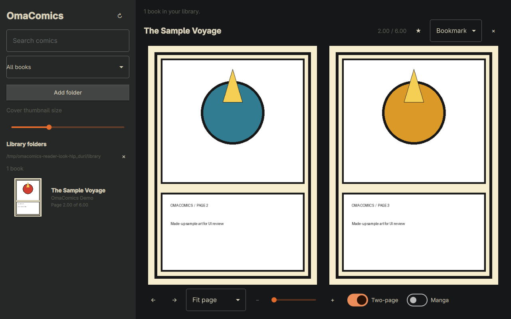

# OmaComics

OmaComics is a keyboard-friendly comic library and reader for Omarchy. It scans selected folders in place, reads `ComicInfo.xml` metadata when present, and never modifies the original comics.

The library supports CBZ, CBR, CB7, CBT, and PDF files. Search, collections, recently read, bookmarks, page progress, and adjustable cover thumbnails are included. The reader supports single pages, two-page spreads, right-to-left manga order, fit modes, zoom, and panning.

On startup, OmaComics checks library folders for new or changed files instead of re-indexing every book. Existing libraries keep their saved metadata; archive page indexes are built as needed for covers and reading.

The companion `kel.omacomics` bar widget shows the current title and progress. Click it for resume/open actions; use Omarchy's normal bar controls to move it. Right-click opens the library directly.

## Install

**Manual reader setup is required.** This repository contains both the native reader (`src/`) and the Omarchy Quattro bar plugin (root `manifest.json`, `BarWidget.qml`, `ReadingStatus.js`, and `i18n/`). Installing the plugin alone does not compile or install the reader. There is no published reader package or prebuilt binary yet.

### 1. Install the native reader

On Omarchy/Arch, install the build and runtime dependencies explicitly:

```sh
sudo pacman -S --needed git base-devel cmake qt6-base qt6-declarative qt6-svg 7zip poppler ttf-dejavu
```

This package-manager command requires administrator approval. All following build and installation commands run as your normal user. An existing XDG desktop portal is required for folder/file selection; Omarchy supplies it. `7zip` provides `7z` for CBZ/CBR/CB7/CBT archives; Poppler provides `pdfinfo` and `pdftoppm` for PDFs. The font package is needed by headless UI tests. Optional `libsecret` supplies `secret-tool` for secure API-key storage; without it, keys remain session-only and the app reports the limitation.

Clone this repository into a source directory you control, review the source, then build, test, and install:

```sh
git clone https://github.com/kelmankenberg/OmaComics.git
cd OmaComics
git rev-parse HEAD
bin/test
cmake --install build --prefix "$HOME/.local"
"$HOME/.local/bin/omacomics" --version
```

CMake 3.21+, a C++17 compiler, and Qt 6 Core, Gui, Network, Qml, Quick, QuickControls2, DBus, Concurrent, and Test are required. No third-party source is downloaded during the build. Installation writes only the reader binary, desktop entry, icon, and license under `~/.local`; it does not modify desktop configuration or install services. Ensure `~/.local/bin` is on the desktop session's `PATH` (the Omarchy default) so the widget can launch `omacomics`.

### 2. Install and enable the bar plugin

```sh
omarchy plugin add https://github.com/kelmankenberg/OmaComics.git --enable
omarchy bar put kel.omacomics --section right
```

Left-click the icon for reading progress and reader launch buttons. Right-click opens the reader. The icon uses the theme accent while a comic is in progress and returns to the normal foreground when none is in progress. The popup follows the desktop language and direction; English and Danish catalogs are included, with English fallback for other languages.

The plugin manager obtains this repository separately from the reader source checkout. Updating the plugin does **not** rebuild the native reader: update your source checkout, review the changes, and repeat `bin/test` and the CMake installation command. Keep the two installations on matching versions. The marketplace's verification applies to its exact reviewed commit, not automatically to later upstream changes.

## Remove

Remove the bar plugin with Omarchy's plugin manager:

```sh
omarchy plugin remove kel.omacomics
```

For the user-local reader installation above, remove only these installed files:

```sh
rm -- "$HOME/.local/bin/omacomics" \
  "$HOME/.local/share/applications/omacomics.desktop" \
  "$HOME/.local/share/icons/hicolor/scalable/apps/omacomics.svg" \
  "$HOME/.local/share/licenses/omacomics/LICENSE"
```

Close the reader before removing it. These commands do not remove your source checkout, comics, library, settings, reading history, backups, saved credentials, or image cache. To remove a stored Comic Vine key, use **Settings > Comic Vine > Forget API key** before uninstalling. A reader installed with a different CMake prefix must be removed from that prefix instead; the commands above apply only to `~/.local`.

## Permissions, privacy, and marketplace review

The bar plugin runs inside Omarchy's unsandboxed shell. It watches only the reader's local status file, `${XDG_DATA_HOME:-~/.local/share}/omacomics/current.json`, and launches the fixed `omacomics` or `omacomics --resume` commands on user action. Status titles are bounded and displayed as plain text, never interpolated into commands or tooltips. The plugin itself makes no network requests and starts no timers, services, privileged commands, or automatic installers.

The reader scans folders you explicitly add, reads comics in place, and writes its index, preferences, backups, and generated cache under the XDG data/cache locations or the backup folder you choose. It never rewrites comic archives. Startup scanning defaults on and can be disabled. Comic Vine access is opt-in per lookup and uses HTTPS; API keys use the desktop Secret Service when enabled and available. Feedback and API-key links open your browser only when clicked. No analytics, telemetry, automatic uploads, or background metadata scraping are included.

**Maintainer notes:** this is a bar widget with a separately built native application and manual setup. The documented package installation and source build may require marketplace capability review (`package-manager`, `privilege`, `remote-build` or `installer`, as detected by the current baseline). They are disclosed setup requirements, not automatic work performed by the widget. Request the marketplace's **manual-setup** classification when submitting. The MIT license and upstream template attribution are in `LICENSE`; the screenshot is made-up demo artwork. Listing and automated checks are not a security audit or guarantee of approval.

## Library and settings

Choose **Add folder** in OmaComics to select a library. The app persists its index and reading progress under `~/.local/share/omacomics/`.

Type a word or phrase and press Enter to add a search chip. All chips must match; remove any chip with its × button.

Use the **List view** and **Folder tree** buttons beside **Library folders** to switch between the existing cover list and an expandable directory tree. The same compact button group includes Comic Vine scraping and the ⋮ selection menu. The view choice is remembered. Both views use the same search, All books/Recently read, and collection filters. Check comics to select several, or check a folder to select every matching comic in it and its subfolders, even when collapsed. Unchecking a folder clears those comics; partially selected folders show a mixed checkbox. The ⋮ menu can select all visible comics or clear the selection. Changing filters removes hidden comics from the selection.

Select **Scrape…** to look up selected comics using the [Comic Vine API](https://comicvine.gamespot.com/api/). Enter your own API key locally; it is masked and excluded from application files and library backups. With **Remember API key securely** enabled (the default), `secret-tool` saves it in the desktop Secret Service credential store and retrieves it on later launches. The helper is optional: without it, or if the store is unavailable or access is cancelled, the app explicitly reports that storage is unavailable or failed and never falls back to a plain-text file. Uncheck the option for session-only keys, or choose **Forget API key** to remove a saved key. No metadata is fetched at startup or while indexing. **Search** sends only the editable query and API key to Comic Vine over HTTPS, never comic files or their full paths. Choose a result, review the missing fields, then **Apply and next**, or **Skip**. Filename-derived titles can be filled; other existing metadata and reading progress are preserved. Scraped metadata stays in the local library index across restarts and rescans, with a safety backup before application. Original archives are never changed.

Comic Vine supplies titles, series, issue numbers, publication years, writers, publishers, and summaries when available; covers still come from the local comic. The API is for personal, non-commercial use under [Comic Vine's terms](https://comicvine.gamespot.com/api/). Lookups are cached for the session and spaced at least 20 seconds apart per API resource to stay below its documented 200 requests/resource/hour limit. Rate-limit and connection errors are shown in the review dialog; closing it cancels pending requests. No matches are applied automatically.

Open **Settings** using the gear beside the title or `Ctrl+,`. Settings temporarily replaces the left library panel; the back arrow or Escape returns to the library without changing the open comic or filters.

The category chooser provides **Startup**, **Reading**, **Library**, **Backups**, **Image cache**, **Comic Vine**, and **Feedback**. Preferences are saved atomically in `~/.local/share/omacomics/settings.json`, separately from the index, and survive restarts and index restoration.

**Startup** can open the library (default), preview the last comic without opening the reader, or resume reading automatically. A file passed on the command line or `--resume` takes precedence. **Reading** remembers fit mode, zoom, and single/two-page layout. Arrow keys, wheel navigation, and mouse buttons are independent persistent preferences, all enabled by default; the reader's navigation menu offers the same controls.

Manga direction is **per comic**, not a global preference. Change the current comic with the reader's Manga switch. To apply it to several comics, check comics or whole folders in the library, then choose **Manga direction for selected** or **Left-to-right for selected** in its selection menu. Folder selection includes matching descendants, including collapsed subfolders. The direction survives rescans and restarts.

**Library** remembers list/tree view, thumbnail size (including no thumbnails), and sidebar visibility. **Check library at startup** defaults on; disable it for manual-only library scans. Scans check file stamps and index only new or changed files, asynchronously. You can open indexed comics and continue turning pages while other books are being indexed; a requested unindexed book is prioritized.

Under **Backups**, choose the folder for automatic daily backups, safety backups, and **Back up now**, or restore an existing index. The default is `~/.local/share/omacomics/backups/`. Changing the location leaves existing backups where they are. This machine-local choice is saved in `~/.local/share/omacomics/settings.json`, separately from the library, and is not changed by restoring an index. An unavailable backup folder is reported rather than silently switching locations.

Automatic retention defaults to **30 days**; choose 7, 30, or 90 days, or **Keep forever**. After a successful automatic snapshot, cleanup runs in the background in the current backup folder. It removes recognized expired `daily-*.json` and new `safety-*.json` snapshots, retaining the selected number of calendar days including today. **Manual backups are never pruned.** Older `omacomics-*.json` files are also kept because previous versions used that prefix for both manual and safety backups. Unknown, malformed, and symlinked files are not removed. Changing to a shorter retention period can remove expired automatic snapshots immediately.

Restoring replaces the current library and reading history after confirmation. OmaComics saves one daily backup and a safety backup before removing a folder, removing a recent-history entry, applying scraped metadata, or restoring an index. Backups contain the index and reading progress, not comic files. Removing a folder never deletes the files.

**Image cache** measures generated covers and page images and can clear them after confirmation, once the reader is closed and background extraction has finished. Page-list indexes, original comics, metadata, bookmarks, and reading progress are retained, so clearing images does not force a full library reindex. Visible covers may be generated again immediately.

**Comic Vine** contains API-key configuration and a persistent choice of series/issue-number searches (default) or title searches. Lookups always remain manually initiated, reviewed, and fill-missing-only.

Under **Feedback**, **Report a bug** and **Request a feature** open the corresponding GitHub issue forms in your browser. Review and submit them yourself with a GitHub account; no diagnostics, library paths, or files are automatically attached. The forms live in `.github/ISSUE_TEMPLATE/` and become available when published on the repository's default branch.

In the reader, the ⋮ menu independently enables arrow keys, the mouse wheel, and mouse buttons for page navigation. Right-click advances and left-click goes back. The wheel scrolls an enlarged page before turning at its edge; drag or use the scrollbars to pan.

## Keyboard

| Key | Action |
| --- | --- |
| `Return` | Read the selected comic |
| `Left` / `Right` | Turn pages |
| `Space` / `Backspace` | Next / previous page |
| `B` | Toggle a bookmark |
| `Ctrl+B` | Show or hide the library panel |
| `Ctrl+,` | Open or close Settings |
| `Escape` | Return from Settings, or close the reader |
| `?` | Show shortcuts |
| `Q` | Quit |
